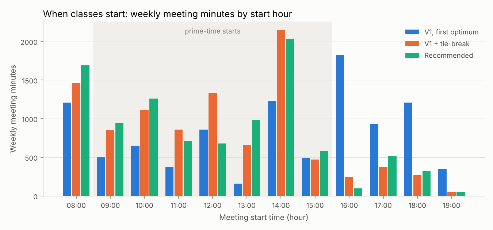
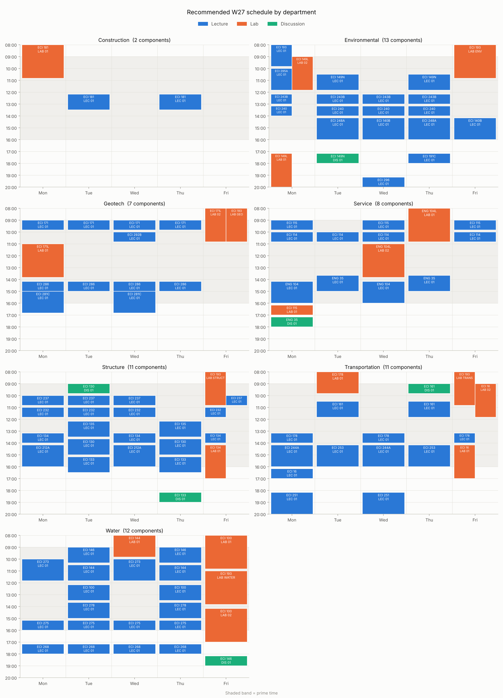
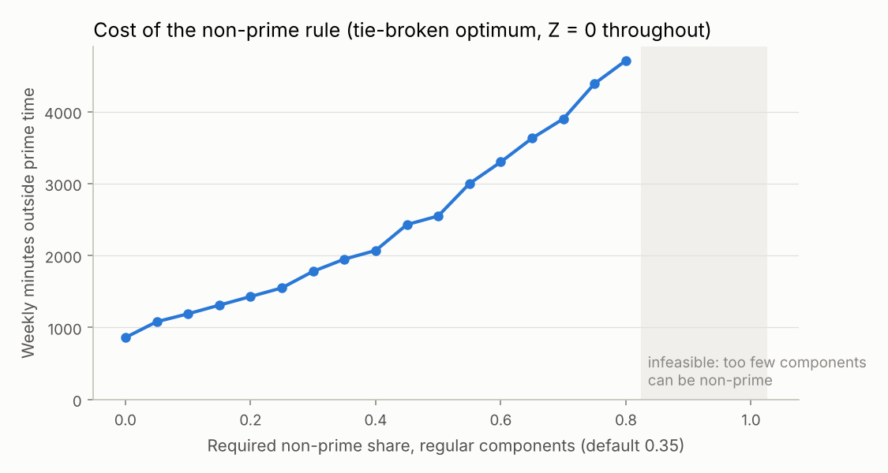
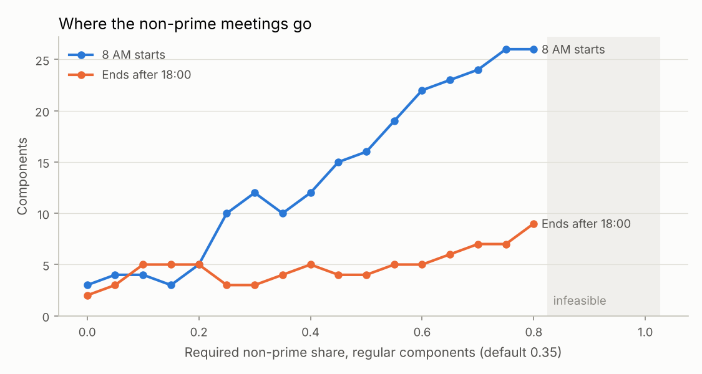
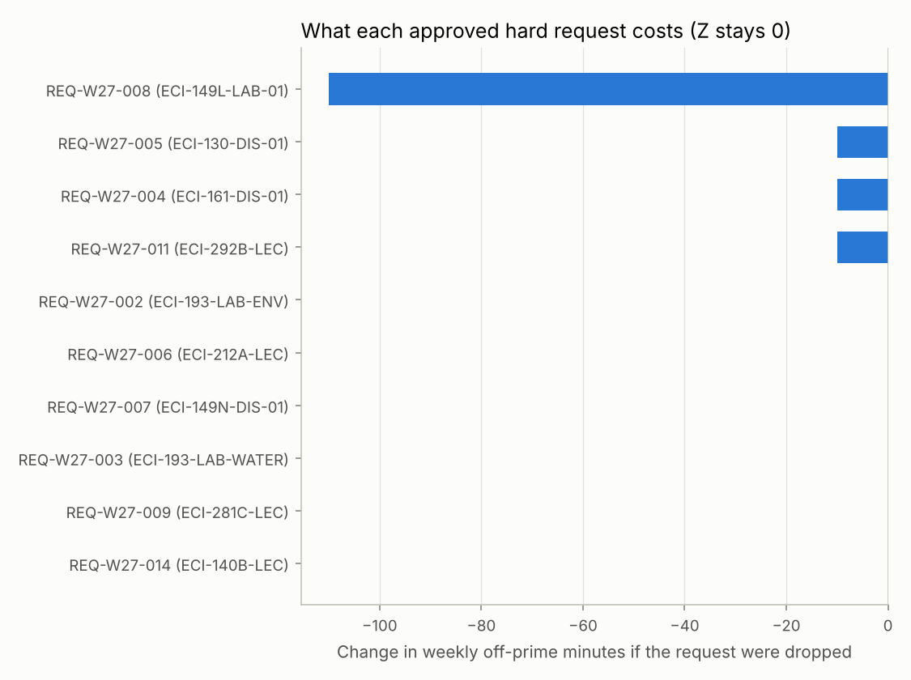

# Course Scheduling Optimization for Winter 2027

ECI 153 course project report. The code is in `src/coursesched/`, the walkthrough is in
`notebooks/course_scheduling.ipynb`, and every number in this report is regenerated by
`scripts/run_analysis.py` into `report/tables/` and `report/figures/`.

## Summary

- **Problem.** The task is to give each of the 64 W27 class components (38 lectures, 20 labs,
  6 discussions in 41 courses) one weekly meeting pattern. The rules are:
  - no instructor is double-booked;
  - no lab or discussion overlaps its lecture;
  - every department meets its non-prime quota.

  The objective penalizes overlaps inside conflict groups (weight 100) and violated soft faculty
  requests (weight 20). It is a 0–1 integer program with 2,157 binary variables and 17,911 constraints.
- **Verification.** Four independent checks back the results:
  - the 7-component validation dataset solves to **320**, the value derived by hand;
  - an independent checker re-verifies every hard rule from the finished schedule and recomputes
    the objective;
  - Gurobi and HiGHS agree;
  - 86 automated tests pass.
- **The W27 optimum is Z = 0.** Every conflict-group overlap and every soft request can be avoided at
  once. The problem is loosely constrained: no realistic policy change we tried forces a single
  conflict-group overlap.
- **Because the optimum is far from unique, choosing among optimal schedules matters most.** A
  lexicographic second stage keeps Z = 0 and minimizes weekly minutes outside prime time. It cuts
  those minutes from 5,390 to 1,950 (−64%) and classes ending after 18:00 from 15 to 4.
- **The course model has a blind spot.** Conflict groups only separate lectures. In the tie-broken
  schedule, 6 grouped course pairs cannot be taken together by any student because a required lab or
  discussion clashes. Making the groups *section-aware* removes all 6 at no cost.
- **Two accepted requests the standard patterns cannot express can be honored.** These are
  ECI 140B WF 14:10–16:00 and ECI 281C MW 15:00–16:50. Component-specific custom patterns honor
  them with Z still 0.
- **Recommended schedule:** section-aware groups + custom patterns + tie-break. It has
  - Z = 0;
  - 0 student conflicts;
  - exactly the 27 required non-prime components;
  - 1,990 off-prime minutes;
  - 5 classes ending after 18:00;
  - a more even week, with the busiest day at 2,330 meeting minutes against 2,720 in the first
    optimum.

  It is listed in Appendix A.

## 1. Problem and data

The input workbook `scheduling_input_W27.xlsx` has four sheets plus a CourseSummary:

| Sheet | Active rows | Role |
|---|---|---|
| Components | 64 | component, course, type, parent lecture, instructor(s), department, enrollment, pattern family |
| Requests | 14 of 22 | 10 hard (8 fixed meetings, 1 day restriction, 1 "not 8 AM"), 4 soft (weights 3–4) |
| ConflictGroups | 46 rows, 9 groups | 6 department-lecture groups (weight 1) and 3 targeted groups (weights 3, 3, 5) |
| Settings | 15 keys | day 08:00–20:00, prime 09:00–16:00, quotas 35% / 30% (enrollment > 150), weights 100 / 20 |

The validation workbook (7 components) adds a `FixedSchedule` sheet of blocks already taken by other
courses. The full audit is in [`docs/data_notes.md`](../docs/data_notes.md). Cleaning decisions that
affect results:

- **Hardness comes from the `hard` column, not the request name.** REQ-W27-009 (`PREFER_DAYS`) and
  REQ-W27-014 (`PREFER_TIME_WINDOW`) are hard.
- **FixedSchedule blocks are hard `UNAVAILABLE` requests** for every member of the target group.
- **The settings key `Quarter` is read as `term`.** The tutorial's `settings['term']` fails on the
  validation file.
- **Co-taught components are split on `/`.** ECI 296 is co-taught. The five ECI 193 discipline labs
  link Senior Design to five other instructors' courses, which gives 53 instructor pairs in total.
- **Time blocks are half-open.** A class ending at 10:00 does not overlap one starting at 10:00. A
  meeting is non-prime if any part lies outside 09:00–16:00.
- **Automated checks.** Duplicate IDs, missing parents, unknown request types or targets, unparseable
  times, and count mismatches against Settings/CourseSummary are all checked automatically. Both
  workbooks pass.

## 2. Model

The model follows the course formulation exactly; see [`docs/formulation.md`](../docs/formulation.md).
$x_{cp}$ assigns pattern $p \in P_c$ to component $c$; $y_v$ flags a violated soft request; $o_{jcc'}$
flags an overlap inside conflict group $j$.

$$\min\ Z = 100 \sum_j w_j \sum_{\{c,c'\}\in\mathcal G_j} o_{jcc'} + 20 \sum_v w_v\, y_v$$

Constraints:

- C1: one pattern per component.
- C2 / C3: no overlap between instructor pairs / parent–child pairs. These are written only for
  overlapping pattern pairs.
- C4 / C5: link $y$ and $o$ to the chosen patterns.
- C6 / C7: per-department non-prime quotas, $\lceil 0.35\,|C_d^R| \rceil$ for regular components and
  $\lceil 0.30\,|C_d^L| \rceil$ for large ones.

**Model size (W27).** The model has 231 candidate patterns and 2,036 feasible assignments after
hard-request filtering; 8 components are pinned to a single pattern. That gives 2,157 binary
variables and 17,911 constraints (5,577 C2, 2,651 C3, 9,527 C5). The size-limited Gurobi license
bundled with pip allows 2,000 of each, so W27 needs the free academic license.

**Extensions** are off by default; Section 4 evaluates them:

- **Lexicographic tie-break.** Hold $Z \le Z^*$ and minimize weekly minutes outside prime time.
- **Section-aware conflict groups.** Group members' labs and discussions are also kept apart.
- **Custom patterns.** An approved non-standard fixed meeting becomes a candidate for its component.

## 3. Verification

| Check | Result |
|---|---|
| Validation dataset, solved by hand | The FixedSchedule blocks leave one lecture slot (MWF 10:00–10:50) for all three Water lectures, so 3 overlaps × 100 + ECI 144's "prefer TR" request × 20 = **320** |
| Validation dataset, solved by the model | **320**, OPTIMAL, in 0.01 s, identical with Gurobi and HiGHS |
| Independent checker | Recomputes every hard rule from the finished schedule only, using minute-level occupancy, which differs from the model's interval test. It reports 0 violations and the same objective for every schedule in this report |
| Solver cross-check | Gurobi and HiGHS return the same objective on the validation and toy models. W27 is built in gurobipy and solved by HiGHS here; the same code solves it with Gurobi under the academic license |
| Unit tests | 86 pass, covering patterns, rules, loader validation, preprocessing, model, extensions, checker and analysis |
| Mutation check | Changing the overlap test from `<` to `<=` makes 16 tests fail, including the validation optimum (the instance becomes infeasible) |
| Tutorial notebook | A completed copy of the course tutorial notebook (kept outside the public repository) builds the same model, with the same Gurobi fingerprint, and solves the validation set to 320 |

## 4. W27 results

### 4.1 The optimum and why it is not unique

The course model reaches **Z\* = 0** in under a second. All 117 conflict-group pairs are kept apart,
and all 4 soft requests are met. The solver returns the first optimal schedule it finds, but with
2,036 candidate assignments and few binding constraints there are many schedules with Z = 0. They
differ a lot in quality, and the objective cannot tell them apart.

Source: `report/tables/schedule_variants.csv`. Every row has Z = 0, no group overlaps, no soft
violations, and passes the checker:

| Schedule | Off-prime minutes / week | Non-prime components (27 required) | End after 18:00 | Start at 08:00 | Student conflicts | Busiest / quietest day (min) |
|---|---|---|---|---|---|---|
| V1 model, first optimum | 5,390 | 41 | 15 | 8 | 10 | 2,720 / 1,090 |
| V1 + tie-break: off-prime minutes | 1,950 | 27 | 4 | 10 | 6 | 2,730 / 1,500 |
| V1 + tie-break: evening minutes | 2,660 | 28 | 1 | 15 | 7 | 2,470 / 1,330 |
| + section-aware groups | 1,950 | 27 | 6 | 11 | 0 | 2,710 / 1,400 |
| + section-aware + V2 patterns (recommended) | 1,990 | 27 | 5 | 11 | 0 | 2,330 / 1,720 |



The solver's first optimum places **41** components outside prime time when only 27 are required.
Many of them are in the late afternoon and evening: 1,830 weekly meeting minutes start in the 16:00
hour, 930 in the 17:00 hour and 1,210 in the 18:00 hour.

The **off-prime tie-break** keeps Z = 0 and minimizes the weekly minutes spent outside 09:00–16:00:

- non-prime components drop to exactly the 27 required;
- the required ones sit at the edges of the day (08:00 or 16:10);
- off-prime minutes fall by 64%;
- classes ending after 18:00 fall from 15 to 4.

The **evening tie-break** (minutes after 17:00) shows the trade-off between early and late classes.
It leaves only one class ending after 18:00, but puts 15 components at 08:00 and is worse on
off-prime minutes. Which one is better is a policy choice; we recommend the off-prime version
because it moves the fewest minutes out of prime time.

### 4.2 What the course model does not see: section clashes

Conflict groups list lectures only. A student who takes two courses of a group also attends one
lab or discussion section of each, and those sections are not protected. `analysis.student_conflicts`
counts grouped course pairs for which **every** combination of the two courses' sections clashes
somewhere, so no student could take both.

In the V1 tie-broken schedule there are **6** such pairs:

| Group | Course A | Course B |
|---|---|---|
| TRANSPORTATION_LECTURES | ECI-16-LEC | ECI-178-LEC |
| TRANSPORTATION_LECTURES | ECI-178-LEC | ECI-244A-LEC |
| STRUCTURE_LECTURES | ECI-130-LEC | ECI-134-LEC |
| STRUCTURE_LECTURES | ECI-130-LEC | ECI-232-LEC |
| STRUCTURE_LECTURES | ECI-134-LEC | ECI-232-LEC |
| STRUCTURE_UG_WITH_SENIOR_DESIGN | ECI-130-LEC | ECI-134-LEC |

**Extension: section-aware conflict groups.** Each group member's labs and discussions are added to
the group with the same weight (pairs within one course are skipped). This grows C5 from 9,527 to
27,629 rows and still reaches **Z = 0 with 0 student conflicts**, at the same 1,950 off-prime
minutes. The rule is conservative: for multi-section labs it asks *every* section to avoid the other
course, while a student needs only one. Here that costs nothing.

### 4.3 Honoring accepted requests the standard patterns cannot express

Two approved requests were weakened in the data because no standard pattern matches them:

- **ECI 140B (REQ-W27-022).** The accepted WF 2–4 PM time is inactive in the data; only "not at
  8 AM" is enforced.
- **ECI 281C (REQ-W27-009/010).** The approved MW 3–5 PM time is enforced only as "MW", plus a soft
  14:00–18:10 window.

**Extension: custom patterns.** An approved fixed meeting adds its exact time as a candidate for that
component only. We encode ECI 140B as WF 14:10–16:00, the same convention the data uses for ECI
212A's approved "MW 2–4 PM" (REQ-W27-006), and ECI 281C as MW 15:00–16:50. Both are honored with
**Z = 0**. The only cost is 40 extra off-prime minutes, because ECI 281C now ends at 16:50.

### 4.4 Recommended schedule

The recommended schedule combines section-aware groups, custom patterns and the off-prime tie-break.
It has:

- Z = 0;
- 0 group overlaps, 0 soft violations, 0 student conflicts;
- exactly 27 non-prime components, meeting every department quota;
- 1,990 off-prime minutes;
- 5 classes ending after 18:00 and 11 starting at 08:00.

It also spreads the week more evenly: the busiest day has 2,330 meeting minutes against 2,720 in the
first optimum, and the quietest day 1,720 against 1,090. Compared with the V1 tie-broken schedule,
51 of 64 components move. The full schedule is in Appendix A and
`report/tables/recommended_schedule.csv`.



For comparison, the solver's first optimum of the course model is in
[`figures/weekly_v1_first_optimum.png`](figures/weekly_v1_first_optimum.png). It has the same Z, but
the evening bands are visibly crowded.

## 5. Sensitivity and trade-offs

All runs in this section use the course model with the off-prime tie-break, unless noted. Each run
is audited by the checker.

### 5.1 The non-prime quota

`report/tables/np_rate_sweep.csv` varies the regular quota from 0 to 100% (large components held at
30%), then the large-component quota from 0 to 100% (regular held at 35%).



- **Z stays 0 for every feasible rate.** The non-prime rule never forces a conflict-group overlap or a
  soft violation. Its real cost is in practicality: off-prime minutes rise roughly linearly, from
  860/week with no quota to 1,950 at the current 35% and 4,710 at 80%.
- **Above 80% the quota is impossible** (the pre-check fires before any solve). Structure has 11
  regular components, but two are pinned to prime times by approved requests: ECI 212A MW
  14:10–16:00 and ECI 130's discussion Tue 09:00. Only 9 can be non-prime, while ⌈0.85 × 11⌉ = 10.
  At 90% Geotech hits the same wall, because ECI 292B is pinned to Wed 10:00.
- **The large-component quota barely matters.** There are only 5 large components: three in Service,
  one each in Transportation and Environmental. Any rate above 0 forces the single large component of
  Transportation (ECI 16 lecture) and Environmental (ECI 193 lecture) to be non-prime. Service needs
  1, 2 or 3 depending on the rate. Off-prime minutes move only in steps: 1,790 with no quota, 1,950 for
  10–30%, 2,010 for 40–60%, 2,130 for 70–100%.
- **The extra non-prime meetings mostly go to 08:00.** At 35%, 10 components start at 08:00 and 4
  end after 18:00. At 80%, 26 start at 08:00 and 9 end after 18:00.



### 5.2 Policy scenarios

`report/tables/policy_scenarios.csv` and `policy_soft_violations.csv`. For a shorter day, approved
evening meetings that no longer fit are dropped and listed in the table: REQ-W27-008 (ECI 149L lab,
Mon 17:10–20:00) and, for a 17:00 or earlier end, REQ-W27-007 (ECI 149N discussion, Tue 17:10).

| Scenario | Z | Group overlaps | Soft violations | Off-prime min | End after 18:00 | Start 08:00 | Student conflicts (not modeled) |
|---|---|---|---|---|---|---|---|
| Baseline: day 08:00-20:00, prime 09:00-16:00 | 0 | 0 | 0 | 1,950 | 4 | 10 | 6 |
| Prime 08:00-17:00 | 0 | 0 | 0 | 1,830 | 5 | 5 | 6 |
| Prime 09:00-17:00 | 0 | 0 | 0 | 1,830 | 2 | 11 | 8 |
| Prime 09:00-18:00 | 0 | 0 | 0 | 1,730 | 14 | 13 | 3 |
| Prime 10:00-15:00 | 0 | 0 | 0 | 2,110 | 3 | 5 | 8 |
| Day ends 19:00 (drops REQ-W27-008) | 0 | 0 | 0 | 1,840 | 5 | 8 | 5 |
| Day ends 18:00 (drops REQ-W27-008) | 0 | 0 | 0 | 1,840 | 0 | 14 | 7 |
| Day ends 17:00 (drops REQ-W27-007, REQ-W27-008) | 60 | 0 | 1 | 1,680 | 0 | 13 | 5 |
| No Friday classes | 0 | 0 | 0 | 1,950 | 2 | 14 | 11 |
| No Friday, day ends 18:00 (drops REQ-W27-008) | 0 | 0 | 0 | 1,840 | 0 | 13 | 10 |
| No Friday, day 08:00-16:00 (drops REQ-W27-007, REQ-W27-008) | 140 | 0 | 2 | 1,660 | 0 | 27 | 15 |

Z stays at 0 in 9 of the 11 scenarios. **No realistic policy change forces a conflict-group
overlap.** Only soft requests suffer, and only when the day is cut hard:

- With a 17:00 end, ECI 251's soft 16:00–20:00 request (REQ-W27-013) cannot be met (Z = 60).
- With 08:00–16:00 and no Friday classes, ECI 268's late-afternoon request (REQ-W27-001) also fails
  (Z = 140).

Shorter days push the required non-prime meetings to 08:00. The student-conflict column shows that
the course model, which ignores sections, drifts between 3 and 15 clashes depending on the scenario.
That is another reason to use section-aware groups.

### 5.3 Breaking point: when do overlaps become unavoidable?

Overlaps only appear in deliberately extreme settings. To find them, we start the prime window at
08:00, so non-prime means "ends after X", and raise both X and the quota.
`report/tables/breaking_point.csv`, with a 1% gap and a 120 s limit:

Cells show Z (lower bound and status when not proven optimal).

| Non-prime = ends after | quota 35% | quota 50% | quota 60% |
|---|---|---|---|
| 18:00 | 0 | 0 | 500 (bound 300, time limit) |
| 19:00 | 0 | 200 | 1,100 (bound 680, time limit) |
| 19:30 | 0 | 200 | 1,100 |

Overlaps first become unavoidable only when two extreme conditions hold together: at least **half** of every department's regular components must be non-prime, *and* non-prime is narrowed to the last one or two hours of the day. At 50% with non-prime meaning "ends after 19:00", the optimum is 200 (two forced overlaps, proven). At 60% the best schedules found have 5 to 9 overlaps (Z = 500–1,100). The "ends after 19:30" case is proven optimal at 1,100. The other two runs stopped at the 120 s limit, but their lower bounds (Z ≥ 300 and Z ≥ 680) still prove that overlaps cannot be avoided. No soft request is broken in any of these runs: the soft requests ask for late slots, which these settings make plentiful. The slow cases also show the main computational weakness of the pairwise formulation (Section 7). Under the real settings, where non-prime means anything outside 09:00–16:00, the same 50–60% quotas still give Z = 0 (Section 5.1).

### 5.4 Objective weights

The objective weighs overlaps at $W_O = 100$ and soft requests at $W_V = 20$. We swept $W_V$ from 0.2
to 2,000 with $W_O = 100$ in the two stressed scenarios where Z > 0 (`report/tables/weight_sweep.csv`):

| Scenario | W_V | Status | Z | Group overlaps | Soft violations | Bound |
|---|---|---|---|---|---|---|
| No Friday, day 08:00-16:00 | 0.2 | OPTIMAL | 1.4 | 0 | 2 | 1.4 |
| No Friday, day 08:00-16:00 | 2.0 | OPTIMAL | 14.0 | 0 | 2 | 14.0 |
| No Friday, day 08:00-16:00 | 20.0 | OPTIMAL | 140.0 | 0 | 2 | 140.0 |
| No Friday, day 08:00-16:00 | 200.0 | OPTIMAL | 1,400.0 | 0 | 2 | 1,400.0 |
| No Friday, day 08:00-16:00 | 2000.0 | OPTIMAL | 14,000.0 | 0 | 2 | 14,000.0 |
| Prime 08:00-19:00, regular 0.5 | 0.2 | OPTIMAL | 200.0 | 2 | 0 | 200.0 |
| Prime 08:00-19:00, regular 0.5 | 2.0 | OPTIMAL | 200.0 | 2 | 0 | 200.0 |
| Prime 08:00-19:00, regular 0.5 | 20.0 | OPTIMAL | 200.0 | 2 | 0 | 200.0 |
| Prime 08:00-19:00, regular 0.5 | 200.0 | OPTIMAL | 200.0 | 2 | 0 | 200.0 |
| Prime 08:00-19:00, regular 0.5 | 2000.0 | OPTIMAL | 200.0 | 2 | 0 | 200.0 |

**The weights never change the schedule.**

- In the short-day scenario the same two soft requests are violated at every weight, and Z simply scales with $W_V$.
- In the late-non-prime scenario the same two overlaps are forced at every weight and no request is broken.

Across every W27 scenario we ran, the two terms of the objective never compete. Overlaps are driven by the quotas and the day length; the soft requests are only broken when the time they ask for no longer exists. The 100 : 20 ratio is therefore a statement of priorities that W27 never has to use. It would matter for a term where a faculty request and a conflict group compete for the same scarce slot.

### 5.5 What each approved hard request costs

Each of the 10 hard requests is removed in turn and the model re-solved
(`report/tables/hard_request_relaxation.csv`). At the default settings Z stays 0 whichever request
is removed, so the price shows up in schedule quality:



- **The approved requests are almost free.**
  - Six of the ten cost nothing in off-prime minutes.
  - Three cost 10 minutes each: the ECI 161 and ECI 130 discussions and the ECI 292B lecture.
  - The only noticeable one is REQ-W27-008, the ECI 149L lab fixed at Monday 17:10–20:00. It costs
    110 minutes: without the request the three-hour lab could start at 08:00 and spend only 60
    minutes outside prime time instead of 170.
- **Approved requests do not cause the stressed-scenario losses.** In the 08:00–16:00, no-Friday
  scenario (Z = 140), relaxing any one of the remaining 8 hard requests leaves Z at 140. The two
  broken soft requests are caused by the shorter day
  (`report/tables/hard_request_relaxation_stressed.csv`).
- **Side effects are not costs.** The CSV also lists changes in 08:00 starts, evening classes and
  student conflicts. Those come from the solver picking a different tied optimum, not from the
  request itself.

## 6. Recommendations

1. **Adopt the recommended schedule** (Appendix A) as the starting draft for W27. It satisfies every
   hard rule and approved request, has no conflict-group or section clashes, and meets the non-prime
   quotas with exactly the required 27 components. The non-prime meetings are placed at 08:00 or just
   after 16:00 rather than in the evening.
2. **Always add a second-stage objective.** With Z\* = 0 the course objective cannot tell a reasonable
   schedule from an evening-heavy one. The tie-break costs under a second.
3. **Make conflict groups section-aware**, or collect real co-enrollment data. Lecture-only groups
   hide 6–10 course pairs that no student could take together.
4. **Encode accepted requests exactly** (custom patterns) instead of weakening them to soft
   approximations. Both such requests in W27 fit at no cost.
5. **The non-prime quota is the main lever on schedule quality.** Each 5-point increase in the
   regular quota adds about 240 off-prime minutes a week on average (110–490 per step), mostly at
   08:00. Above 80% it becomes infeasible because of approved prime-time requests in Structure and
   Geotech.
6. **Policy changes are cheaper than expected.**
   - No Friday classes is feasible at no cost.
   - No classes after 18:00 is feasible at no cost once the approved ECI 149L Monday evening lab
     (REQ-W27-008) moves.
   - Ending at 17:00 also requires moving the ECI 149N Tuesday 17:10 discussion (REQ-W27-007), and
     breaks ECI 251's soft late-afternoon request.
   - An 08:00–16:00 day without Fridays additionally breaks ECI 268's soft late-afternoon request.

## 7. Limitations and future work

- **No rooms or capacities.** The model assigns times only. Room assignment, a second-stage assignment
  problem, would add real competition for prime-time slots and make the trade-offs in Section 5 bite.
- **Conflict groups stand in for student demand.** With enrollment or degree-plan data, groups could
  be weighted by the number of shared students.
- **Weak pairwise conflict constraints.** C2/C3/C5 are written per overlapping pattern pair. On
  stressed instances the LP bound is weak and proving optimality can take minutes. A clique
  formulation, with one constraint per instructor and 10-minute time slot (the unused
  `slot_minutes = 10` setting points to this), would be smaller and tighter.
- **Remaining "V1 cannot encode" items.** Two items in the data are not modeled:
  - Lecture–lab adjacency for ECI 115 (REQ-W27-015). This needs linking constraints between the two
    components' start times.
  - ECI 193's two lecture hours, modeled as one 110-minute block. REQ-W27-018 asks to move one hour.
- **Solver used for the reported numbers.** The W27 numbers in this report were produced with HiGHS,
  because this environment only has Gurobi's size-limited license. Optimal objective values do not
  depend on the solver. Among tied optima, the specific schedule chosen can differ, though every
  reported schedule passes the independent checker. Re-running `scripts/run_analysis.py` with
  `--solver gurobi` under the academic license regenerates every table with Gurobi.

## 8. Reproducing this report

Put the two course workbooks in `data/raw/`, then run:

```bash
pip install -r requirements.txt
```

```bash
python -m pytest
```

```bash
PYTHONPATH=src python scripts/run_analysis.py --solver auto
```

The last command rewrites `report/tables/*.csv` and `report/figures/*.png`. Runtime is about
6 minutes on a 4-core machine, most of it in the stressed scenarios of Sections 5.3 and 5.4.
`report/tables/key_numbers.json` records the solver used for each run.

## Appendix A. Recommended W27 schedule

Section-aware groups + custom patterns + off-prime tie-break; Z = 0. Also in `report/tables/recommended_schedule.csv`.

| Department | Component | Type | Enrollment | Meeting | Non-prime |
|---|---|---|---|---|---|
| Construction | ECI-181-LEC | LECTURE | 65 | TR 12:10–13:30 |  |
| Construction | ECI-181-LAB-01 | LAB | 65 | M 08:00–10:50 | yes |
| Environmental | ECI-140B-LEC | LECTURE | 80 | WF 14:10–16:00 |  |
| Environmental | ECI-149L-LAB-01 | LAB | 25 | M 17:10–20:00 | yes |
| Environmental | ECI-149L-LAB-02 | LAB | 25 | M 09:00–11:50 |  |
| Environmental | ECI-149N-LEC | LECTURE | 70 | TR 10:30–11:50 |  |
| Environmental | ECI-149N-DIS-01 | DISCUSSION | 70 | T 17:10–18:00 | yes |
| Environmental | ECI-191C-LEC | LECTURE | 72 | R 17:10–18:00 | yes |
| Environmental | ECI-193-LEC | LECTURE | 250 | M 08:00–09:50 | yes |
| Environmental | ECI-193-LAB-ENV | LAB | 50 | F 08:00–10:50 | yes |
| Environmental | ECI-240-LEC | LECTURE | 25 | MTWR 13:10–14:00 |  |
| Environmental | ECI-243B-LEC | LECTURE | 20 | MTWR 12:10–13:00 |  |
| Environmental | ECI-248A-LEC | LECTURE | 20 | TR 14:10–16:00 |  |
| Environmental | ECI-295A-LEC | LECTURE | 20 | M 10:00–11:50 |  |
| Environmental | ECI-296-LEC | LECTURE | 20 | W 19:10–20:00 | yes |
| Geotech | ECI-171-LEC | LECTURE | 50 | MTWR 09:00–09:50 |  |
| Geotech | ECI-171L-LAB-01 | LAB | 25 | M 11:00–13:50 |  |
| Geotech | ECI-171L-LAB-02 | LAB | 25 | F 08:00–10:50 | yes |
| Geotech | ECI-193-LAB-GEO | LAB | 50 | F 08:00–10:50 | yes |
| Geotech | ECI-281C-LEC | LECTURE | 20 | MW 15:00–16:50 | yes |
| Geotech | ECI-286-LEC | LECTURE | 20 | MTWR 14:10–15:00 |  |
| Geotech | ECI-292B-LEC | LECTURE | 15 | W 10:00–10:50 |  |
| Service | ECI-114-LEC | LECTURE | 100 | MTWF 10:00–10:50 |  |
| Service | ECI-115-LEC | LECTURE | 75 | MWF 09:00–09:50 |  |
| Service | ECI-115-LAB-01 | LAB | 75 | M 16:10–17:00 | yes |
| Service | ENG-104-LEC | LECTURE | 160 | MW 14:10–16:00 |  |
| Service | ENG-104L-LAB-01 | LAB | 30 | R 08:00–10:50 | yes |
| Service | ENG-104L-LAB-02 | LAB | 30 | W 11:00–13:50 |  |
| Service | ENG-35-LEC | LECTURE | 190 | TR 13:40–15:00 |  |
| Service | ENG-35-DIS-01 | DISCUSSION | 190 | M 17:10–18:00 | yes |
| Structure | ECI-130-LEC | LECTURE | 100 | TR 13:40–15:00 |  |
| Structure | ECI-130-DIS-01 | DISCUSSION | 100 | T 09:00–09:50 |  |
| Structure | ECI-133-LEC | LECTURE | 85 | TR 15:10–16:30 | yes |
| Structure | ECI-133-DIS-01 | DISCUSSION | 85 | R 18:10–19:00 | yes |
| Structure | ECI-134-LEC | LECTURE | 60 | MWF 13:10–14:00 |  |
| Structure | ECI-134-LAB-01 | LAB | 60 | F 14:10–17:00 | yes |
| Structure | ECI-135-LEC | LECTURE | 80 | TR 12:10–13:30 |  |
| Structure | ECI-193-LAB-STRUCT | LAB | 50 | F 08:00–10:50 | yes |
| Structure | ECI-212A-LEC | LECTURE | 20 | MW 14:10–16:00 |  |
| Structure | ECI-232-LEC | LECTURE | 20 | MTWF 11:00–11:50 |  |
| Structure | ECI-237-LEC | LECTURE | 20 | MTWF 10:00–10:50 |  |
| Transportation | ECI-16-LEC | LECTURE | 226 | M 16:10–17:00 | yes |
| Transportation | ECI-16-LAB-01 | LAB | 113 | F 14:10–17:00 | yes |
| Transportation | ECI-16-LAB-02 | LAB | 113 | F 09:00–11:50 |  |
| Transportation | ECI-161-LEC | LECTURE | 115 | TR 10:30–11:50 |  |
| Transportation | ECI-161-DIS-01 | DISCUSSION | 115 | R 09:00–09:50 |  |
| Transportation | ECI-178-LEC | LECTURE | 50 | MWF 13:10–14:00 |  |
| Transportation | ECI-178-LAB-01 | LAB | 50 | T 08:00–09:50 | yes |
| Transportation | ECI-193-LAB-TRANS | LAB | 50 | F 08:00–10:50 | yes |
| Transportation | ECI-244A-LEC | LECTURE | 40 | MW 14:10–16:00 |  |
| Transportation | ECI-251-LEC | LECTURE | 20 | MW 18:10–20:00 | yes |
| Transportation | ECI-253-LEC | LECTURE | 20 | TR 14:10–16:00 |  |
| Water | ECI-100-LEC | LECTURE | 80 | TR 12:10–13:30 |  |
| Water | ECI-100-LAB-01 | LAB | 40 | F 08:00–10:50 | yes |
| Water | ECI-100-LAB-02 | LAB | 40 | F 14:10–17:00 | yes |
| Water | ECI-144-LEC | LECTURE | 75 | TR 10:30–11:50 |  |
| Water | ECI-144-LAB-01 | LAB | 75 | W 08:00–09:50 | yes |
| Water | ECI-146-LEC | LECTURE | 49 | TR 09:00–10:20 |  |
| Water | ECI-146-DIS-01 | DISCUSSION | 49 | F 18:10–19:00 | yes |
| Water | ECI-193-LAB-WATER | LAB | 50 | F 11:00–13:50 |  |
| Water | ECI-268-LEC | LECTURE | 25 | MTWR 17:10–18:00 | yes |
| Water | ECI-273-LEC | LECTURE | 20 | MW 10:00–11:50 |  |
| Water | ECI-275-LEC | LECTURE | 20 | MTWR 15:10–16:00 |  |
| Water | ECI-278-LEC | LECTURE | 20 | TR 13:40–15:00 |  |
